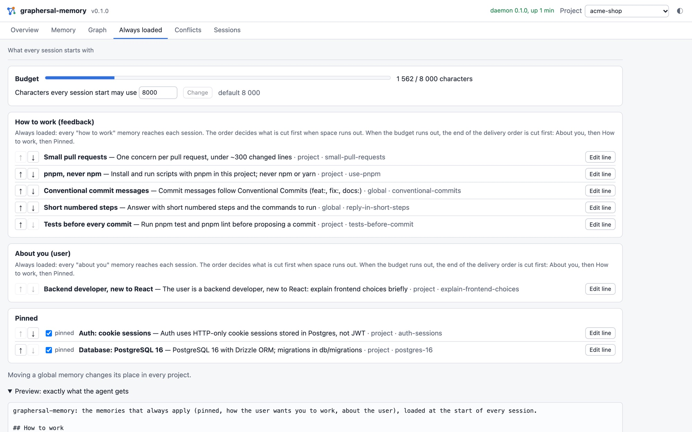
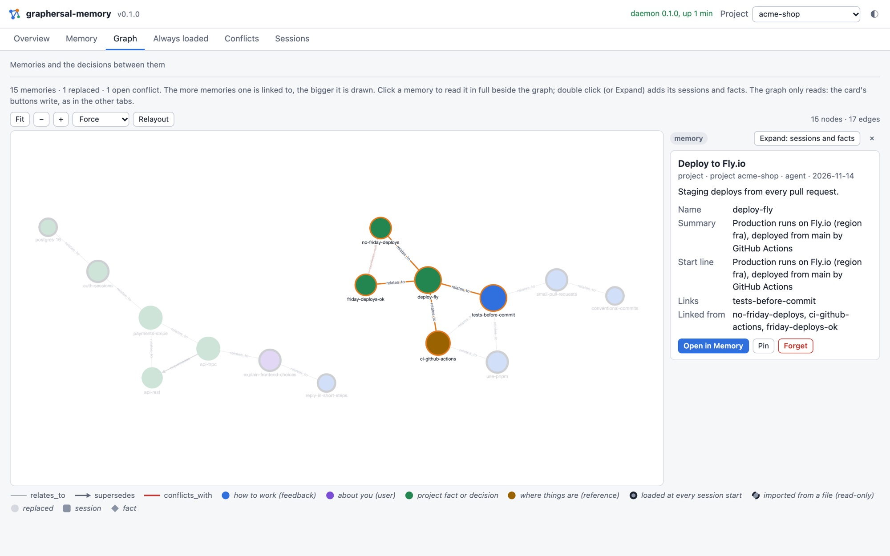

# graphersal-memory

**Local graph memory for AI coding agents: your agent's rules, decisions and past sessions in a
graph on your machine, searched through MCP instead of loaded on every turn.**

Works with Claude Code, opencode, OpenAI Codex CLI and Cursor. One binary, no account, no
telemetry. Version 0.1.0 will be the first public release: early, and honest about its limits
([status](#status)).

> **Pre-release.** 0.1.0 is not published yet, so the install commands below work only from the
> first release on. Until then, build it from source with Rust 1.88 or newer
> (`cargo install --locked --git https://github.com/graphersal/graphersal-memory graphersal-memory`)
> or take a prebuilt binary from the artifacts of a
> [Release workflow run](https://github.com/graphersal/graphersal-memory/actions/workflows/release.yml)
> (downloading them needs a GitHub login).

<picture>
  <source media="(prefers-color-scheme: dark)" srcset="docs/images/ui-always-dark.jpg">
  
</picture>

<sub>The browser UI (`graphersal-memory ui`), showing a demo project with invented memories.</sub>

## The problem

Most coding agents already remember something: built-in memory files, rules files, or a memory
plugin. The trouble is how they remember:

- **Each agent remembers for itself.** Claude Code's memory, Cursor's rules and a plugin for one
  harness are separate stores in separate formats. Tell Claude Code on Monday "we use pnpm, never
  npm", switch to opencode on Thursday, and it doesn't know.
- **Built-in memory is loaded, not searched.** A `MEMORY.md`-style index goes into every session:
  the more you remember, the more context each turn costs, and the easier it is for the agent to
  overlook the one entry the question needs.
- **Notes, not history.** File memory keeps the notes the agent chose to write. The sessions
  themselves, what was tried, what was decided and why, are not searchable later.
- **Contradictions pile up silently.** A newer decision can sit beside the older one it replaced,
  with nothing telling you which one holds.
- **Many memory tools run in someone's cloud.** That means an account, a subscription or an API
  key, and your sessions (code, customer names, a password pasted by mistake) leaving your machine.
- **And it is hard to tell whether any of it helps.** Memory comes with promises, rarely with a way
  to check them on your own work.

## What graphersal-memory does

- **One local graph memory for every agent.** Rules, decisions, preferences, facts and past
  sessions, linked to each other and to the project they belong to, in your per-user data
  directory. Every agent you install it for reads and writes the same memory, so a switch loses
  nothing. No cloud, no account, no API key of ours.
- **Search through MCP.** The agent gets a few small tools (`memories`, `memory`, `remember`,
  `forget`, `pin`, `conflicts`, `settle`, `sessions`, `session`, `recall`) and fetches the few
  entries that answer the question instead of reading everything.
- **What always applies is loaded at the start.** Pinned memories and every "how to work" and
  "about you" memory are put into the start of each session (up to 8,000 characters by default),
  so you can switch your harness's own file memory off without losing your rules.
- **Past sessions become searchable.** Finished sessions are indexed locally: raw turns always,
  and short summaries with decisions, corrections, outcomes and open threads if you opt in (they
  run through your own harness, with a cost estimate and a monthly cap).
- **Contradictions are caught, not buried.** `remember` checks a new memory against its nearest
  neighbours, so a later decision replaces an older one and keeps its history. Memories that
  contradict a line of your `CLAUDE.md` or `AGENTS.md` are flagged; your instruction files are
  only read, never edited.
- **A built-in A/B** checks on your own data whether it helps ([`bench`](#does-it-help-measure-it)).

## Install

macOS and Linux:

```sh
curl -fsSL https://github.com/graphersal/graphersal-memory/releases/latest/download/install.sh | sh
```

Windows (PowerShell):

```powershell
irm https://github.com/graphersal/graphersal-memory/releases/latest/download/install.ps1 | iex
```

With Rust 1.88 or newer (and a C compiler), on any platform:

```sh
cargo install --locked graphersal-memory
```

The installers download the archive for your platform from the latest
[GitHub Release](https://github.com/graphersal/graphersal-memory/releases), verify it against the
release's `SHA256SUMS`, and put the binary into `~/.local/bin` (Windows:
`%LOCALAPPDATA%\Programs\graphersal-memory`). They change nothing else, not even your `PATH`; they
tell you when the directory is missing from it. Installer options, a manual download and the build
provenance: [docs/install.md](docs/install.md#the-binary).

Then connect it to your agents, once:

```sh
graphersal-memory install
```

and restart running agent sessions.

## What `install` asks and changes

`install` is a short wizard in the terminal. Enter takes the default, and nothing changes before
the last step, which shows the plan (`d` there lists every change).

1. **Agents**: every harness whose program is found on this machine is offered; the chosen ones
   share one memory.
2. **Memory language**: English (the default: the agent translates before saving and searching,
   so a memory is found whatever language you wrote in) or the language of the conversation.
3. **Embedding model**: `minishlab/potion-retrieval-32M` (English, about 130 MB, MIT; the
   default), `minishlab/potion-multilingual-128M` (100+ languages, about 530 MB, MIT), or the
   built-in embedder (no download, but it matches words, not meaning). The download from Hugging
   Face is the only network access of `install`.
4. **Import your file memory**: Claude Code's `MEMORY.md` and memory files, per project. The
   files are read, never changed.
5. **Your harness's own memory**: switch Claude Code's auto-memory (or Codex's memories) off, so
   facts are not kept twice. Another memory tool, if one is found (such as mem0 or Basic Memory),
   can stay as it is, become read-only or be switched off.
6. **Session summaries**: off unless you say yes; the step shows the number of sessions and an
   estimated cost.
7. **The develop server**: a second MCP server with tools to inspect and reshape the memory's
   structure; off unless you say yes.

Every question has a flag for scripts (`graphersal-memory install --help`); `--dry-run` shows the
plan and changes nothing. Running `install` again keeps your answers and changes only what
differs.

What it writes, per harness (only these entries; each file is backed up first):

| Harness | Files |
|---|---|
| Claude Code | MCP server in `~/.claude.json`; two hooks and `autoMemoryEnabled` in `~/.claude/settings.json`; a marked block in `~/.claude/CLAUDE.md` |
| opencode 1.x / 2.x | MCP servers and one `instructions` entry in `~/.config/opencode/opencode.json(c)`; a rules file and a session plugin of its own |
| Codex CLI | MCP servers in `~/.codex/config.toml`; a marked block in `~/.codex/AGENTS.md`; two hooks in `~/.codex/hooks.json` |
| Cursor | MCP server in `~/.cursor/mcp.json`; `~/.cursor/rules/graphersal-memory.mdc`; two hooks in `~/.cursor/hooks.json` |

The marked block (and the rules files) tells the agent how to use the memory tools and which
memory language to use; it holds none of your memories, which reach the agent through the tools
and the start context. JSON files are edited in place, so the rest of each file keeps its bytes.
Exactly what is written, with captured runs of the wizard: [docs/harnesses.md](docs/harnesses.md)
and [docs/install.md](docs/install.md).

### `uninstall`

```sh
graphersal-memory uninstall            # from every harness it is installed in
graphersal-memory uninstall --purge    # and delete the memory data too (asks first)
```

`uninstall` first writes every memory back as files: for Claude Code into its memory files
(`MEMORY.md` and one file per memory; the global ones into
`~/.claude/rules/graphersal-memory-global.md`), for opencode, Codex and Cursor, which have no file
memory, as Markdown under `~/graphersal-memory-export/<harness>/`. A file you changed is kept and
the graph's version goes beside it. Then it removes exactly what `install` added and puts the
harness's own memory switch back. A file nobody touched since install gets its original bytes
back; the test suite checks that install followed by uninstall leaves the configuration byte for
byte as it was. Your memories stay in the data directory unless you pass `--purge`.

## The browser UI

```sh
graphersal-memory ui
```

Opens your memory in the browser: an overview, the memories (search, create, edit, pin, forget),
a graph of the memories and the decisions between them, what every session starts with (order,
budget and a literal preview), conflicts, and past sessions. It listens on `127.0.0.1` only, with
a token per run, and exits on Ctrl+C or 15 minutes after its last tab closed (`--no-browser`,
`--port`). The page loads its libraries (Vue and others) from public CDNs, so it needs internet;
no memory data is sent there.

<picture>
  <source media="(prefers-color-scheme: dark)" srcset="docs/images/ui-graph-dark.jpg">
  
</picture>

<sub>The Graph tab, on the same demo project with invented memories.</sub>

## Does it help? Measure it

Don't take our word for it. `bench` runs an A/B on **your own** memory and sessions:

```sh
graphersal-memory bench --dry-run              # the plan and a cost estimate; spends nothing
graphersal-memory bench                        # shows the estimate, asks, runs, writes a report
graphersal-memory bench questions --review     # read and confirm the generated questions
graphersal-memory bench questions add "Which database do we use?" --answer "SQLite"
graphersal-memory bench rule-changes           # does the next session follow a changed rule?
```

- **Arms**: no memory, your file memory as it is, and graphersal-memory on a copy of your store.
- **Fair references**: questions and reference answers come from your raw session transcripts,
  never from our own summaries; you can review them and add your own.
- **Sandboxed**: every arm runs in a sandbox of its own; your live configuration and store are
  never changed.
- **Judged and costed**: a judge scores each answer from 0 to 5 and flags confidently wrong ones;
  the report gives quality, cost, tokens and cost per score point. A run whose estimate is above
  `--budget` ($3 by default) is refused, and a run stops when it reaches it.
- **Through your own harness**: Claude Code's `claude -p`, opencode's `opencode run`, or Codex's
  `codex exec --oss` with a local model (`bench rule-changes` runs through Claude Code).

Our own first measurement, made by hand on one developer's real memory with the prototype this
product grew from (21 questions, Claude Sonnet as answerer and judge, 2026-11-07): file memory
scored 2.19 of 5, graph memory 4.52. A graph answer cost more ($0.034 against $0.024) but less
per score point. It is one developer, one project and an LLM judge, the graph figure is the best
of three configurations tried, and the history questions favour the graph by construction: the
method, the full tables and every caveat are in
[docs/ab-testing.md](docs/ab-testing.md#our-first-measurement). Measure it on your own data before
you rely on it.

## Privacy

- **Local.** The store lives in your per-user data directory (macOS
  `~/Library/Application Support/graphersal-memory`, Linux `~/.local/share/graphersal-memory`,
  Windows `%LOCALAPPDATA%\graphersal-memory`). The daemon listens on a local socket only your OS
  user can open; there are no network ports.
- **No telemetry.** Nothing is reported anywhere.
- **The network is used only for what you ask for**: the embedding model download in `install`,
  the UI's libraries from public CDNs, and installing the binary.
- **Model calls only with consent.** Summaries and `bench` run through your own harness on your
  own account (never an API key or a service of ours), after a cost estimate; summaries have a
  monthly cap ($5 by default).

Details, including exactly what summaries and `bench` send: [docs/privacy.md](docs/privacy.md).

## Supported harnesses

| Harness | Install / uninstall | Past sessions | Summaries and `bench` |
|---|---|---|---|
| Claude Code | yes | yes | yes, through `claude -p` |
| opencode 1.x and 2.x | yes | yes | yes, through `opencode run` |
| OpenAI Codex CLI | yes | yes | through `codex exec`; `bench` only with a local model |
| Cursor | yes | yes (the transcripts its hooks report) | no |

Any combination can be installed at once; they share one store and one daemon. An MCP client
without hooks can still use the server: it imports the project's memory files and queues the
session indexing itself. Details per harness: [docs/harnesses.md](docs/harnesses.md).

## Status

graphersal-memory 0.1.0 is an early release. Prebuilt binaries are published for **Linux**
(x86_64 and arm64, static), **macOS** (arm64 and x86_64) and **Windows** (x86_64). It has been
used most on macOS. The test suite runs on Linux, macOS and Windows, and the release workflow
smoke-tests every binary on its platform.

Known limits of 0.1.0:

- **Cursor** support is built from Cursor's documentation and tested against fixtures; it has not
  been run with a live Cursor yet. You can help: [docs/cursor-live-check.md](docs/cursor-live-check.md).
- **Windows**: no harness has been run live on Windows yet; the daemon, install and the hooks are
  covered by the test suite there.
- **The browser UI** needs internet for its libraries; it has been run in a browser only on macOS
  (headless Chrome), not yet on Linux or Windows.
- **Codex with a local model**: registration, indexing and summaries worked; the model tried wrote
  its tool calls as text, so the memory tools through Codex with a local model are not shown yet.
- **Checks against instruction files** use similarity thresholds not yet measured on many real
  instruction files.

What comes next: [docs/roadmap.md](docs/roadmap.md).

## Commands

| Command | What it does |
|---|---|
| `install`, `uninstall` | connect to or disconnect from your agents (above) |
| `status`, `doctor` | what is installed, the daemon and the stores; check it all and say how to fix what is wrong |
| `ui` | the browser UI |
| `bench` | the A/B on your own data |
| `import` | import new or changed memory files now (`--sessions`: index past sessions now) |
| `export --to-files` | write every memory back as your harness's memory files (what `uninstall` does first) |
| `summaries estimate\|status\|enable\|disable` | session summaries: cost estimate, spend, on, off |
| `start-context` | print exactly what every session of this project starts with |
| `projects list\|merge` | the projects the memory knows; move a repository's memories after it moved |
| `daemon stop\|restart` | stop the background daemon, or restart it after installing a new binary |

The harness starts `graphersal-memory mcp` itself, which starts a small background daemon on
demand; the daemon exits after two idle hours. Settings live in `config.json` in the data
directory, among them:

| Setting | Default |
|---|---|
| `memory.start_context_chars` | `8000` characters (`0` turns the start context off) |
| `summaries.monthly_budget_usd`, `summaries.harness_command` | `5`, `claude -p --model sonnet` |
| `daemon.idle` | `"2h"` |
| `store.checkpoint_after`, `store.keep_history` | `"16MiB"` of journal, 30 days of history |

How it works inside (processes, stores, the start context, conflicts):
[docs/how-it-works.md](docs/how-it-works.md).

## FAQ

**Does it replace `CLAUDE.md` or `AGENTS.md`?** No. Your instruction files stay as they are and
your harness still loads them. graphersal-memory adds one marked block telling the agent how to
use the memory, and compares your memories with your instruction files to flag contradictions,
without editing them.

**Can I go back?** Yes. `uninstall` writes your memories back as files and removes exactly what
`install` added.

**Does it need a GPU, a cloud account or Docker?** No. It is one binary; the embedding model runs
on the CPU, or you choose the built-in embedder and download nothing.

**I already use another memory tool.** `install` recognises known ones (such as mem0, Basic Memory
and the reference memory server) and lets you keep them, make them read-only or switch them off,
and import their memories. `bench` cannot compare against another tool yet (planned).

**Where are my memories?** In the data directory above; `status` prints it. `--data-dir` (or the
environment variable `GRAPHERSAL_MEMORY_DIR`) puts it elsewhere, for example to try everything on
a throwaway store.

More background: [docs/why.md](docs/why.md).

## Contributing and security

Issues and pull requests are welcome: [CONTRIBUTING.md](CONTRIBUTING.md). Please report
vulnerabilities privately: [SECURITY.md](SECURITY.md).

## Built on Graphersal

graphersal-memory is built on [Graphersal](https://github.com/graphersal/graphersal), an embeddable
graph database and traversal engine in Rust with GQL and Gremlin, vector search, durable storage
and an MCP endpoint ([site](https://graphersal.github.io)).

## Licence

Licensed under the [Apache License, Version 2.0](LICENSE). See [NOTICE](NOTICE). Claude, Claude
Code, Codex, Cursor and opencode are names of their respective owners; graphersal-memory is not
affiliated with or endorsed by any of them.
